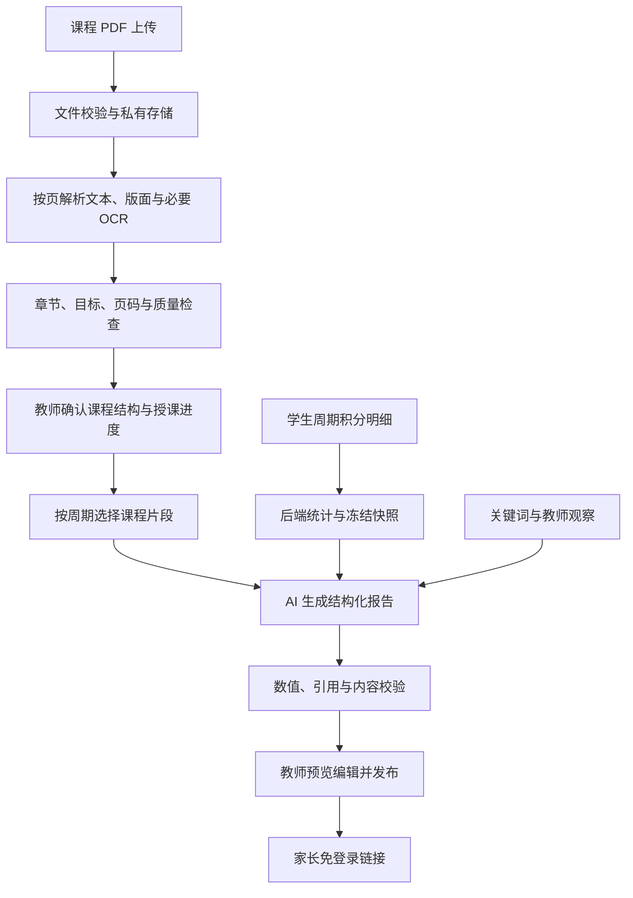

# 学期报告功能实施方案

日期：2026-09-27。工作分支：`featuer/semester-reports`，从本地 `main` 创建。

本方案已按确认的积分口径和可替换服务开始实施。代码包含教师端主流程、队列、私有 PDF 存储及免登录报告页；连接真实 OCR/AI 供应商和真实课程资料评测仍需环境凭据与样本。下列产品规则和容量限制是首版约定，需结合真实课程 PDF 继续验收。

已确认：AI 与 PDF 解析服务商暂不指定，采用可替换方案；首版继续使用综合积分生成各学科报告，仅预留将来按学科记分与筛选的扩展。

## 1. 功能范围与默认规则

统一入口叫「学期报告」，支持周报、月报、学期报告；一份报告对应一个学生、一个学科、一个明确日期区间。首版教师手动发起，周期表示统计范围，不表示自动定时生成。可多选学生批量生成，每名学生独立任务、独立报告和家长链接。

教师操作流程：

1. 建立学期（名称、开始与结束日期）及学科。
2. 为「学期 + 学科 + 年级/班级」上传课程 PDF，查看解析结果，确认章节、教学目标和授课进度。
3. 选择报告周期、学科、班级、学生，填写关键词；可另填具体的教师观察。
4. 查看本周期积分概览、课程范围、资料完整性提示，提交生成任务。
5. 后台生成草稿，教师查看依据、编辑正文并发布，获得免登录链接。
6. 历史列表查看生成流程、重试失败任务、重新生成新版本、复制或撤销链接、删除报告。

建议默认教师审核后发布；生成成功返回草稿 ID，发布成功返回家长链接。若产品决定直接生成并公开，可配置自动发布，但必须先通过同样的数据与输出校验。首版完整链路采用审核发布。

家长页采用移动端可滚动 HTML，包含学生姓名、学科、周期、课程内容、周期结束时的宠物形态、成长亮点、待改进点和家庭建议。PDF 是输入资料；导出报告 PDF 可后续补充。

首版按现有教师账号隔离，各教师维护自己的学科和资料；不默认打通不同教师的学生、积分及教材。学校共享课程库、多教师协作归入后续范围。

## 2. 代码现状与必须解决的问题

| 已核查位置                                                             | 现状                                                                | 实施影响                                                                   |
| ---------------------------------------------------------------------- | ------------------------------------------------------------------- | -------------------------------------------------------------------------- |
| `apps/backend/src/pet-points/entities/pet-evaluation-record.entity.ts` | 有学生、类别、标签、分值、备注、创建时间，无学科                    | 按时间范围查询综合评价明细；预留可空学科字段                               |
| `apps/backend/src/pet-points/pet-points.service.ts`                    | 余额有零下限，兑换消耗余额，删除评价会回退并物理删除记录            | 报告统计评价分，不把余额当周期所得积分；生成时冻结事实快照                 |
| `apps/backend/src/pet-points/pet-points.database.ts`                   | 学生存在逻辑 ID 与带教师前缀的存储 ID，部分同步按班级和学号回退查找 | 新增明确的学生关联，不能只按姓名匹配积分                                   |
| `apps/backend/src/auth/teacher-context.ts`                             | 教师上下文依赖当前 HTTP 请求                                        | 后台 worker 使用显式 tenant/teacher 参数，不能直接依赖 request-scoped 服务 |
| `apps/web/app/api/backend-proxy.ts`                                    | 要求登录，使用 `request.text()` 转发正文，按 JSON 解析返回          | 文件上传使用专用二进制/流式通道；公开读取用单独接口                        |
| `apps/web/proxy.ts`                                                    | 普通业务页面未登录会跳转登录                                        | 精确放行家长报告路径，不放开全部报告管理接口                               |
| `apps/web/app/layout.tsx`                                              | 全局布局有居中与 `overflow-hidden`                                  | 为公开长报告实现独立滚动容器或路由布局，验收移动端长文                     |
| `deploy/compose.backend.yml`                                           | 后端 384MB 内存、Node heap 256MB；部署文档按 2C2G 设计              | 不把大型 OCR/视觉模型塞进现有后端进程                                      |

目前未发现既有课程 PDF 上传、文档解析、AI 生成或可靠后台任务模块，需要补齐这些能力。

## 3. 数据口径：先保证报告说的事实正确

### 周期

- 时区默认 `Asia/Shanghai`，保存具体起止时间和时区，SQL 使用 `[start, end)` 半开区间。
- 周报默认周一到下周一；月报按自然月；学期使用教师配置的校历日期，周/月范围与学期相交后展示实际范围。
- 当前尚未结束的周期，截止到提交任务时刻，标注「截至某日某时」；未来周期拒绝生成。
- 历史 MySQL DATETIME 的时区必须抽样核对，不直接假定旧数据均为 UTC；新增字段统一约定 UTC 存储和连接时区。

### 积分

- 后端确定性计算：加分合计、扣分绝对值合计、净评价分、评价次数、类别/标签分布、按周趋势，以及有限数量的代表性记录。
- 净评价分 = 本周期评价记录的 `SUM(delta_score)`，允许负值；与当前可兑换余额、宠物成长值明确区分。比如余额为 0 时记 -2，本周期评价分仍包含 -2。
- 奖品兑换不作为负面学习评价。手动调整单列，缺乏语义的「补分」不能解释为积极发言或学科能力。
- 已确认首版不改变加减分操作，使用学生当前周期的全部综合评价。不同学科报告复用同一份综合表现快照，各自结合对应课程 PDF 生成不同的学习建议，不把综合分重新命名为语文/数学等学科分。
- 数据层预留可空 `subject_id`，现有与首版新记录均为 NULL；统计策略记录 `score_scope=overall`。未来可开启学科选择并增加 `score_scope=subject`，届时按学科过滤、综合表现单列；服务端验证学科归属。旧报告保持原快照与统计策略，不随功能开启改变。
- 没有学科专属评价是首版预期情况，统一说明「表现依据来自综合积分，无法据此判断学科知识掌握程度」；没有任何评价记录时另说明资料不足，不表述为零努力或表现差。
- 未登记过的课堂表现不能当作未发生；评价频率可能不同，首版不做班级排名、掌握率、百分位或随意评分。
- 只有历史数据覆盖完整且口径一致时才提供周期比较；当前月未结束时不直接与整月比较总分。

### 学生关联和快照

在 `pet_points_students` 增加可空 `source_student_id`，关联统一学生表；同步学生时填写。历史回填先匹配同教师下逻辑 ID，再核对班级与学号；冲突或截断 ID 无法确认时要求修复映射，不用姓名强行合并。

报告读取仍带教师条件，积分关联到真实宠物学生存储 ID。生成时保存学生姓名/班级展示快照、统计明细摘要与来源 ID、统计截止时间、课程版本、进度版本和关键词。之后改名、删评价、换教材不静默修改已经发布的报告。

现有记录已经被删除的历史无法复原，界面明确报告基于当前留存记录，不声称有完整历史。后续转班数据没有历史班级字段时，也不推断原任课关系。生成前预览最终使用的记录范围。

教师在生成页面切换已选学生时，展示该学生于所选起止日期内的宠物积分加减合计和逐条记录。日期按上海时区解释，结束日期含当天，数据库用半开区间查询；预览只读当前教师可访问的学生。提交时重新计算并冻结积分，草稿和家长报告均显示该快照，编辑正文不得修改积分事实。总数和合计覆盖全部记录，逐条展示上限为 80 条并注明截断；家长端只收到标签、分值和时间，不收到内部 ID 或备注。旧报告从已保存快照补充显示，不根据现时积分重算。

填写阶段、报告模板、家长页及长图统一展示周期结束时的宠物伙伴，原积分统计字段保留后台正文依据，详见历史宠物章节。

## 4. PDF 处理：上传一次，解析复用

推荐首版使用私有对象存储 + 外部文档解析服务 + 可替换的文本生成模型。现有服务器保留业务逻辑、数据库任务队列和轻量结果处理。解析器与模型是两个独立接口，避免绑定同一家厂商。

### 上传与解析任务

1. 教师先选学期、学科、适用班级/年级、资料类型（教材、教学计划、补充资料）。每个课程资料集允许多个 PDF，每份有独立不可变版本。
2. 申请短期、限定对象路径和大小的上传凭证，浏览器直传私有对象存储；完成后服务端核实真实大小、签名、文件哈希、页数和所有权，再创建解析任务。不能只信扩展名、客户端 MIME 或完成回调。
3. 开发环境可用私有本地存储适配器和专用流式上传接口；文件不放 `public/`，生产有持久卷或对象存储，不落在随部署丢失的容器文件层。
4. 首版建议上限 30MB、300 页/文件，均可配置且不超过服务商限制；加密、损坏、伪造 PDF 给出明确错误。解析沙箱限制内存、耗时、页数和解压体积；不执行文档内脚本或访问文档内 URL。
5. 按页判断质量。正常文字页提取文本及阅读顺序；无文本、乱码或扫描页走 OCR；图片、公式、表格密集页用版面解析或视觉服务补充。混合 PDF 不能因为第一页有文字就跳过其余扫描页。
6. 标准化输出页级文本、标题层级、表格、必要图片说明、物理页码、印刷页码（若可识别）、块位置和质量标记。低质量相关页需要教师修正/补传；部分成功不能显示为全部解析完成。
7. AI 从这些结构提取课程单元、目标和关键词，每项绑定原始页码/块 ID；结构化结果仍需校验，原始解析内容保留供教师核对。
8. 以教师范围内的 `file_hash + parser_version + options + extraction_prompt_version` 去重缓存；跨教师不复用可见内容或索引。重试优先使用已完成结果。更新 PDF 创建新版本，不覆盖旧版。

### 整学期 PDF 如何对应一周或一个月

这比「把 PDF 交给大模型」更关键：教材包含一整学期内容，但未必包含实际授课日期。

- 教学计划中存在日期/周次时，解析为候选进度；教师确认学期起点、假期和实际调整。
- 仅有教材目录时，必须维护班级的章节授课日期/周次，或生成时手选本期已讲章节。不能默认按页数均分教学周。
- 数据结构记录 `class_id + term_id + subject_id + unit_id + start/end + confirmed_by`，允许同一本教材不同班级进度不同。
- 未确认授课范围时，生成前要求选章节，或显式采用「学期课程背景，未确认本期授课进度」模式；后一模式不声称本周已学某单元。

### 课程检索

先按教师、学期、学科、适用班级、已确认资料版本和授课范围过滤，再按单元/关键词取片段；第一页取样或整本截断不可作为检索方式。

首版每个资料集规模有限，可用章节索引及中文关键词匹配，保留足够的单元上下文与页码，不必立刻引入独立向量数据库。学期报告必须覆盖全部已确认教学单元，采用「单元摘要 + 总结」分层方式；周/月报告只取对应单元。上下文超预算时按单元压缩，不静默丢弃后半学期。

若真实资料验证显示语义召回不足，再增加向量或混合检索；所有检索仍先做权限与版本过滤。无相关片段时返回证据不足，不能跨学科补齐答案。

### 解析方案选择依据

| 方案                                  | 适用性                                                         | 首版结论                                 |
| ------------------------------------- | -------------------------------------------------------------- | ---------------------------------------- |
| 云文档解析/OCR                        | 减少现有服务器计算负担；需按真实中文、扫描、公式和表格样本验证 | 保留为后续可切换选项                     |
| 独立 Docling 解析服务                 | 本地 OCR/表格处理、页码文本；需要独立资源与运维                | 首版默认实现；真实课程样本仍需验收       |
| 每名学生直接发送整本 PDF 给多模态模型 | 小样本验证方便，但重复输入成本高，课程进度和引用不易统一       | 不作为生产主流程；可用于疑难页面补充解析 |

阿里云文档理解官方资料描述了电子版、扫描版、版面、层级和表格提取能力，可作为云解析候选，不能据此保证本项目教材识别质量：[文档理解](https://help.aliyun.com/zh/document-mind/product-overview/overview-of-document-understanding)。Docling 支持模型预下载、表格参数和文档资源限制，可用于独立解析服务验证：[官方高级配置](https://docling-project.github.io/docling/usage/advanced_options/)。厂商选择前先用真实 PDF 评测，不在方案阶段承诺准确率或单价。

## 5. AI 报告生成与质量约束

输入分成三组带标签的材料：课程证据、确定性积分统计/评价记录、教师输入。关键词是写作重点，例如「鼓励、表达能力、学习习惯」；「本月主动朗读两次」应放在教师观察字段并标明来源，不能把关键词本身当作事实。

采用固定 JSON schema，建议输出字段：`summary`、`courseOverview`、`strengths[]`、`areasToImprove[]`、`homeSuggestions[]`、`limitations[]`；每条叙述附 `sourceRefs[]`，标记为课程、评价或教师观察。姓名、学科、日期和所有数值卡片由后端快照填充，AI 不负责算数，也不返回 HTML。

具体约束：

- 课程证据只能证明课程内容，积分证据只能支持记录中的行为；「认真听讲 +2」不能推断「熟练掌握分数运算」。
- 建议可结合本期课程提出，但明确为练习建议，不能伪装成已验证的能力结论。
- 输入模型只用学生占位标识，服务端渲染姓名；不传学号、联系方式、全班名单。教师自由文本另做长度限制与可识别个人信息过滤。
- PDF、评价备注和关键词均视为资料，不能覆盖系统提示或触发工具执行；生成模型不提供网络、数据库写入或文件访问工具。
- 输出按 schema 校验长度、字段、引用 ID 归属与范围，数字与事实快照比对；不明来源、越权引用、错误数值或恶意内容阻止进入可发布状态。
- 格式错误可做一次受限修复，仍失败则保留失败状态及可读原因。语义真实性无法完全靠 schema 保证，教师预览是最后一层质量检查。
- 保存 provider/model、提示模板/schema 版本、输入哈希、token 用量、耗时和错误码；记录执行步骤，不记录或要求模型的隐式思考过程。
- 发布版只保存确认后的正文和公开字段；原始提示、内部备注、失败响应不向家长开放。

建议报告内容示例：课程为「分数的初步认识」，记录为「积极发言 3 次」。可以写「本期记录显示孩子有 3 次积极发言；家庭练习可结合分物品理解分数」，不能写「孩子已熟练掌握分数运算」。

## 6. 异步任务、流程记录和费用

首版使用 MySQL 持久化任务表，worker 独立启动入口并可独立部署，避免为低并发额外引入 Redis。不是 HTTP 请求中等待整份 PDF 解析或 AI 完成，也不使用请求结束即丢失的内存任务。

- 解析状态：`uploaded → queued → parsing → structuring → needs_review → ready`；异常进入 `failed`，删除进入 `deleted`。
- 报告任务：`queued → snapshotting → selecting_sources → generating → validating → succeeded`；支持 `failed/cancelled`。
- 报告生命周期：`draft → published → deleted`，分享链接另有 `active/revoked/expired`。重新生成创建草稿版本，不覆盖已发布版本；发布新版本才切换有效内容。
- 客户端提交返回 `202 + jobId/batchId`，轮询进度；刷新或关闭页面后可在任务列表恢复。批量中一个学生失败不影响其他学生。
- 任务创建与关键流程事件同事务落库；幂等键防止重复点击。worker 通过原子领取、租约、心跳和 attempt/fencing 标识防止重复完成，过期租约可恢复。
- 服务商返回任务 ID 后立即保存并轮询；超时优先查询原任务状态。外部调用不能保证绝对只计费一次，需记录尝试并限制重试；429/暂时网络错误指数退避，密码错误/格式错误不盲目重试。
- 运行时再次检查教师、资料、学生及报告是否仍有效；删除后取消待执行任务，旧 worker 即使收到 AI 返回也不能重新发布。
- worker 使用保存的 teacherId 显式作用域，所有数据库查询及对象存储访问都校验归属；不得接收客户端伪造的教师 ID。
- 初始并发建议全局 1 个解析、2 个生成，每教师 1 个生成；批量最多 30 人，可配置。上线前用实际容器预算压测，再调整。
- 流程事件包含步骤、起止时间、操作者、重试次数、错误原因、关联版本及费用信息；访问记录最多表示「链接被请求」，不能声称某位家长已阅读（链接预览机器人也会请求）。

费用结构：每份课程版本一次解析/OCR + 一次课程结构提取 + 每位学生每份报告的模型输入/输出费用 + 存储。UI 提交前展示人数、已缓存资料、预计消耗范围；单教师日/月限额、单任务输入/输出上限和重试预算可配置。缺少厂商价格时显示用量估算，不编造人民币价格。不得在运行时静默切换到未经配置的数据处理厂商。

## 7. 家长免登录链接、教师删除与内容保留

公开页建议 `/r/{token}`，后端只开放专用 `GET /public/reports/:token`。使用加密安全随机源生成 32 字节 token，以 base64url 编码，数据库存哈希并绑定报告及有效期。只有发布后签发 token；撤销或删除立即失效。

为支持教师在历史列表反复复制同一链接，另保存 token 的加密密文，仅所属教师的管理接口可解密取回。加密密钥放服务端密钥配置，与数据库分离，记录 key version 支持轮换；公开查询只使用 token 哈希。禁止日志记录明文 token。

- 链接只展示一份已发布报告，不提供学生 ID 查报告列表或访问原始课程 PDF 的入口。知道链接的人即可查看并可能转发，这是免登录设计的访问边界。
- 教师可设置到期时间、撤销或重新签发。公开页面和 API 每次读取都校验有效性；页面、数据、CDN 均 `no-store`，禁止 Next 静态生成或 ISR 缓存这类报告。
- `Referrer-Policy: no-referrer`、`X-Robots-Tag: noindex, nofollow, noarchive`，不出现在站点地图；不嵌入第三方分析脚本或外部图片。Nginx、应用日志和错误监控脱敏 token 路径。
- 公开请求做速率限制；无效、过期、已撤销、已删除均显示通用不可访问状态。返回 DTO 只允许已发布字段，不直接序列化实体。
- 删除仅限报告所属教师。事务内设置 tombstone、撤销全部 token、取消队列任务并记录删除事件，随后异步清理正文、快照和私有产物；失败重试并对账。
- 最小流程日志仅保留匿名报告 ID、操作、时间、操作者与清理状态，建议保留 90 天后清理；不能借审计名义永久保留完整学生报告。
- 上传的课程资料独立管理，删除某个学生报告不会删除其他报告仍使用的教材。资料删除需禁用新任务并清理该资料及派生索引；历史报告保存必要引用摘要和「源文件已删除」状态。
- 学生/教师账号删除应触发其公开链接撤销与关联内容清理，补充现有删除入口的集成。备份按部署保留策略到期清理，恢复时重放删除清单，避免已撤销内容重新公开。
- 已经被家长保存或截图的内容无法通过撤销链接追回；删除保证后续服务端访问失效。

## 8. 建议表结构与 API

所有业务表包含教师归属和创建/更新时间；关系写入必须校验同一教师，查询不得只用裸 ID。正式实现使用增量 TypeORM migration，并同步空库 `schema.sql`。

| 表/扩展                                         | 关键内容                                                              |
| ----------------------------------------------- | --------------------------------------------------------------------- |
| `academic_terms` / `subjects`                   | 学期日期、时区；教师学科字典及启用状态                                |
| `pet_points_students.source_student_id`         | 与统一学生表的明确映射                                                |
| `pet_points_evaluation_records.subject_id`      | 可空学科，历史记录保留空值                                            |
| `course_sets`                                   | 学期、学科、年级、资料集合；班级适用关系用关联表                      |
| `course_documents` / `course_document_versions` | 文件类型、私有对象键、哈希、大小、页数、解析状态、版本                |
| `course_chunks` / `course_units`                | 内容、章节、目标、页码、块引用及质量标记                              |
| `teaching_progress`                             | 班级周期到课程单元映射、确认状态与版本                                |
| `student_reports` / `report_versions`           | 学生、周期、科目、状态、发布版本；输入快照、正文 JSON、模型与模板版本 |
| `report_jobs` / `report_events`                 | 任务类型、租约、尝试、进度、幂等键、耗时、用量、错误及审计            |
| `report_shares`                                 | token 哈希、加密密文、密钥版本、报告、到期/撤销时间                   |

关键索引：评价 `(teacher_id, student_id, created_at)` 及按学科查询索引；报告 `(teacher_id, student_id, subject_id, period_start)`；任务 `(status, next_attempt_at, lease_until)`；token hash 唯一；任务幂等键在教师范围唯一。不要对学生/学科/周期做禁止重生成的唯一限制，使用报告版本区分。

| API（Nest 路径）                                                              | 用途                                                           |
| ----------------------------------------------------------------------------- | -------------------------------------------------------------- |
| `/academic-terms`、`/subjects`                                                | 登录教师的学期和学科维护                                       |
| `POST /course-documents/uploads`、`POST /course-documents/:id/complete`       | 申请上传、校验并启动解析                                       |
| `GET /course-documents/:id`、`POST /course-documents/:id/retry`               | 查看解析状态、失败重试                                         |
| `PATCH /course-documents/:id/structure`、`POST /course-documents/:id/confirm` | 修正并确认课程结构                                             |
| `/teaching-progress`                                                          | 设置和查询班级授课范围                                         |
| `POST /reports/preview-input`                                                 | 预览确定性统计、课程范围及资料缺口                             |
| `POST /reports/generate`                                                      | 周期、学科、班级、学生列表、关键词、观察、幂等键；返回任务集合 |
| `GET /reports/jobs/:id`、`POST /reports/jobs/:id/retry`                       | 状态/步骤、重试                                                |
| `GET /reports`、`GET /reports/:id`、`GET /reports/:id/events`                 | 历史、教师详情、流程记录                                       |
| `PATCH /reports/:id/draft`、`POST /reports/:id/publish`                       | 编辑草稿、发布并返回链接；使用版本号防止覆盖他人或旧页面编辑   |
| `POST /reports/:id/regenerate`                                                | 从最新数据创建新草稿，显式显示与旧版差异                       |
| `POST /reports/:id/shares`、`DELETE /reports/:id/shares/:shareId`             | 签发/替换、撤销链接                                            |
| `DELETE /reports/:id`、`DELETE /course-documents/:id`                         | 教师删除报告或课程资料                                         |
| `GET /public/reports/:token`                                                  | 唯一免登录报告读取，返回白名单 DTO                             |

Web BFF 为这些资源增加明确代理入口；公开接口不复用强制登录的 `proxyBackendRequest`。上传不经过其文本转换路径。所有新增输入做服务端 schema/DTO 校验、大小限制和嵌套资源归属验证。

## 9. 可执行开发顺序与完成标准

| 阶段            | 文件/模块落点                                                                                              | 交付与验收                                                                                                                                         |
| --------------- | ---------------------------------------------------------------------------------------------------------- | -------------------------------------------------------------------------------------------------------------------------------------------------- |
| 0：真实资料验证 | 脱敏测试夹具、解析器与模型评测脚本                                                                         | 用至少 3 类 PDF（文字、扫描、图表/公式）及匿名评价样本跑通解析→报告；教师核对章节、页码、OCR 错漏和措辞，记录每页/每报告成本与耗时；确定厂商和区域 |
| 1：数据基础     | `apps/backend/src/academic-terms/`、`subjects/`、`pet-points/`、`database/migrations/`                     | 学期/学科 CRUD、学生映射、综合积分周期 SQL 聚合、可空学科字段与统计策略扩展点；保持日常积分操作不变，旧数据兼容，无数据/跨周月边界测试通过         |
| 2：资料流程     | `course-materials/`、`jobs/`、`storage/`、`ai/` 适配器；Web 资料管理                                       | 私有上传、可恢复解析、结构预览修正、进度确认；刷新后任务恢复，更新资料保留版本                                                                     |
| 3：生成草稿     | `reports/`、独立 worker 入口及提示模板                                                                     | 快照、范围选择、结构化生成、规则校验、编辑和流程日志；首个真实单学生报告可核对依据                                                                 |
| 4：发布与家长页 | `apps/web/components/apps/SemesterReports.tsx`、`app/api/`、`app/r/[token]/page.tsx`、`proxy.ts`、布局适配 | 注册桌面入口；发布返回链接；手机/无痕窗口无需登录；撤销/删除后立即不可读                                                                           |
| 5：批量与上线   | worker 限流/配额、Compose、环境示例、CI、部署说明                                                          | 批量部分失败重试、进程重启恢复、成本上限、内存压测、灰度发布与清理任务验证                                                                         |

建议先完成阶段 0 的真实资料验证，再投入完整页面开发；其结果决定 OCR 选型、限制和成本。尚未提供实际课程 PDF，当前方案不代表真实解析效果已验收。

必须覆盖的测试：

- 教师 A 不能读取或关联教师 B 的 PDF、学科、学生、任务、报告，包含批量请求和后台 worker。
- 周/月/学期边界、时区、跨年、未结束周期；负分、兑换、手动调整、历史无学科和已删评价。
- 文本/扫描混合 PDF、密码/损坏文件、超限、重复上传、OCR 局部失败、伪造完成回调、旧版引用。
- 生成返回非法 JSON、引用不存在/越权、错误数字、PDF 指令注入、服务商超时/限流；证据不足不编造能力。
- 重复提交、租约过期与旧 worker 晚返回、生成期间删除、任务中途重启、快照后积分更改；不得重复发布或复活已删报告。
- 家长链接无痕访问、撤销/过期/删除失效；页面及 CDN 不保留可访问缓存；公开 DTO 无内部字段。
- 30 人批量的部分失败恢复、解析缓存复用、内存和队列积压；测试供应商 mock 保证 CI 不调用付费模型，真实模型另做小规模人工质量验收。

发布采用功能开关，先迁移新增表/可空字段，再部署后端和 worker，最后开放前端。保持旧积分流程兼容；回滚关闭入口和新任务，不执行会删除报告数据的 migration down。把私有文件、清理任务及公开链接撤销纳入恢复演练。

## 10. 当前待定项与默认取值

- 已确认 AI/OCR 厂商暂无指定，按可替换服务设计；具体厂商、数据处理区域和凭据仍待实施阶段配置。
- 已确认首版继续使用综合积分，预留学科选择扩展；报告始终标注综合数据，不能包装成学科积分。
- 发布方式：默认教师审核发布；家长查看不用登录。
- PDF 数量和质量、师生规模及预算：未知，先按上述保守限制做验证和配额，不能据此承诺吞吐和价格。

以上待定项不影响分支和方案交付；功能实施时先推进数据与接口骨架，真实 PDF 评测和厂商配置是验证 AI 质量的前置条件。

## 2026-10-09：PDF 状态与已发布报告长图

教师资料区域新增实际上传百分比/不定进度及等待服务器确认状态；队列和解析任务以突出卡片显示，在手机其它页面仍能看到处理/待确认数量。现有 2.5 秒状态轮询增加错误与手动刷新入口，不改变解析算法、章节规则、OCR 或数据结构。

已发布报告的分享链接旁增加“生成报告图片”：弹窗通过现有同源公开接口读取最新家长报告 DTO，复用报告模板展示同一份周期结束时的宠物快照，生成单张 PNG 后提供预览、复制与下载。复制使用准备好的 PNG 和新的用户点击事件；HTTP/不支持/权限拒绝时保留下载和长按保存提示。失效链接、读取超时、渲染失败可重试；长内容超出可读画布上限时显式报错，不默默截断。手机弹窗可滚动，支持关闭、Escape、Tab 焦点约束、焦点恢复及临时资源释放。

仅 Web 实现及锁文件新增按需加载的 `html-to-image@1.11.13`。复用 `POST /course-documents`、文档状态读取与 `GET /public/reports/:token`，不新增后台接口、公开字段、权限、服务配置或数据库迁移，不访问任意外部分享域名或第三方截图服务。测试在 `SemesterReports.spec.tsx`、`ReportImageDialog.spec.tsx`、`report-image.spec.tsx`，纳入 `pnpm verify`；真实设备剪贴板仍需独立浏览器验收。

## 学期报告v2（2026-10-10）

桌面新增独立「学期报告v2」入口，保留原版。两版复用资料管理、教师反馈、生成队列、审核、发布、撤销链接和图片导出；报告列表按版本隔离，历史报告默认 v1。课程资料共用，不重复上传。v2 按学科独立勾选课程，初始不勾选任何学科；未勾选的学科不进入报告。v2 默认学期周期，初始日期为学期开始至今天或学期结束（取较早者），也支持周/月周期及授课范围。

生成与课程范围预览请求新增 `reportVersion: "v2"`。v2 请求必须提供 `courseSelections: [{ subjectId, courseScope }]`，最多 20 门学科，不允许为空或重复。后端忽略旧的单个 `subjectId`，内部 `*` 仅用于查找当前教师与所选学期的资料；最终仅使用显式勾选学科的已确认 PDF。每门学科分别选择单元、课时或页码，选中学科在学期报告中留空表示该学科全部内容，周/月报告必须分别填写范围。学生报告只包含全班通用资料（`classId: "*"`）及该学生所在班级资料。未确认、解析失败、其他学期和其他教师资料不进入报告。保留最多 20 份 PDF、500 项内容、120000 字的完整性限制，超限明确失败，不能静默截断。任何已选学科无匹配课程页面，或任一学生所在班级缺少已选学科的可用资料时，整批提交失败；不会退回到全部学科。学习内容仍逐项评价，默认待评价；课程计划不能推断知识已掌握。

`snapshot` 保存 `courseSelections`（原始逐学科选择）、实际所选学科名称及资料所属学科 ID、`reportVersion`、周期结束时的宠物字段 `pet`（ID、昵称、等级、形态、是否孵化）、截止时间 `petAsOf`、历史状态 `petHistoryStatus` 及 `classroomPhoto`；宠物历史需执行下述新增迁移。宠物素材与积分模块共用，兼容后端「第N形态」和旧描述形态；无宠物显示待领养，未孵化显示蛋。原版与 v2 均用周期结束时的宠物伙伴替换积分明细展示位置，积分数据仍作为原有教师审核与正文生成依据。预览、家长页、导出图片读取相同快照，后续宠物成长不会改变已发布报告。

老师生成草稿后，在报告窗口上传该学生的最多两张课堂照片，可分别替换或移除。`POST /semester-reports/reports/:id/classroom-photo` 使用 multipart 字段 `file`；只接收 JPG/PNG，校验 MIME、文件头及每张最大 2MB，存储为快照中的 data URL。`DELETE` 同一路径移除。两者均要求当前教师拥有报告、状态为草稿，通过现有行锁与发布操作串行；已发布需先撤销发布再修改。前端保留未保存正文，失败在页面内提示，可重新上传；上传中禁用重复操作。窄屏自适应照片与按钮。照片随家长分享链接可见，仅公开已发布报告；不上传至外部 AI。草稿正文编辑不可伪造或覆盖宠物与照片，重新生成继承逐学科选择与照片，并按原周期结束时间重新读取宠物历史；兼容早期 v2 报告时，只从原快照实际使用的资料推导学科。失败重试使用原先选定页面，不将逐学科范围重新按统一选择器解析。照片较大会增加报告存储和详情响应体积；列表仍不返回正文。

「下一步重点」保留教师输入和草稿编辑位置。空值不在报告预览、家长页或导出图片中显示，仅在创建和编辑表单中保留填写入口。v2 不以扣分或 AI 草拟建议自动填充此栏；后续模板/AI 生成策略尚未接入。已有 AI 模式仍用于其他正文。

部署：同步部署 Web 与 Backend；沿用现有认证、报告代理、数据库 JSON 列、公开链接权限与无缓存策略。反向代理单次上传限制须大于 2MB 并容纳 multipart 开销（现有 30MB 课件上传配置已满足）。未修改 PDF/OCR 或课时提取规则。

验收：回归覆盖两版历史宠物区、v2 版本列表隔离、逐学科范围独立选择/取消选择/空选择/越权学科/未选课程排除、重新生成保留选择、多课程与班级资料选择、宠物形态/蛋/未领养、照片替换移除/文件边界/权限/发布状态、教师重点与预留展示，以及共用导出视图。真实课堂照片上传、家长链接和浏览器图片导出的端到端手工验收仍需在登录环境执行。

v2 首次实现的自动验证：`pnpm verify` 已通过（项目规范与部署测试、Backend 263 项、Web 45 项、Admin 11 项，以及三个应用生产构建）。Web Turbopack 在沙箱内受本地端口限制，完整验证在已授权的沙箱外环境通过；未部署至线上。

逐学科选择调整的自动验证：`pnpm verify` 已通过，覆盖同名单元跨学科隔离、取消选择后排除课程、空/无效/越权选择、缺失课程、重新生成保留选择、切换课程保留教师寄语，以及课程资料删除后仍可取消该学科。三端生产构建通过，未部署至线上。

2026-10-10 修复学期周期忽略授课范围的问题：报告周期只决定日期与统计范围，不能覆盖老师选择的课程。学期周期中，每门学科范围留空才表示本学期全部内容；明确选择单元、课时或页码后，预览的「已选学习内容」、资料页码、生成快照与重新生成均按该学科范围过滤。同页的其他课时不进入学习内容，所选课时的跨页目标继续保留；无匹配范围明确失败，不回退到全部课程。共用索引同时遵守原版报告填写的明确范围，空范围学期报告维持原行为。API、权限与数据库结构不变，无迁移；不会改写既有草稿或已发布报告，老师需主动重新生成。回归覆盖默认学期周期下两门学科各选不同课时、预览与快照一致、空范围全部内容、页码选择、跨页与同页隔离、无匹配及越权学科；拼音末尾第 81 课在学期周期中只选第 21 页和该课内容。

同日修复 v2 生成按钮持续禁用：v2 范围预览的 `courseScope` 是多学科展示说明（例如「阅读：Unit1；数学：Unit2」），不能与原版单科输入比较来判断是否可以提交。前端给范围预览附加当前版本、周期、学期和逐学科选择的本地请求标识；只有当前请求成功返回的预览可供生成，切换选择后立即失效，迟到的旧响应不能恢复按钮。已选择学生、日期有效、课程页面非空且学习内容不超限时即可生成；预览加载/失败、无学生、未选学科、零页或超过 500 项内容保持禁用，失败可「重新加载学习内容」后再提交。回归覆盖范围留空/明确课时的 v2 真实展示说明与生成请求、成功后报告列表导航、移除学生、旧响应迟到、权限失败和重试、空页面及数量超限，并保留原版生成流程。仅修改 Web，无 API、权限或数据库迁移，已有报告不受影响。

v2 课堂照片展示调整：草稿编辑与模板预览上方始终提供独立的浅色强调上传区，用带上传图标的大按钮打开文件选择器；无照片为「上传课堂照片」，已有照片为「更换课堂照片」，上传期间禁用，失败保留照片和未保存寄语，可重试或移除。窄屏按钮占满可用宽度。上传后的照片放在报告渐变顶部、班级名称下方，与文字左对齐；宽度随屏幕收缩、最大宽度 24rem、最大高度 16rem，保持整张图片可见。预览、家长页和导出长图使用同一组件，无照片时不显示空照片区域或上传提示。报告不再显示「课堂精彩瞬间」或 v2 的「课堂表现」标题，已填写的课堂表现内容仍保留，空内容不占用单独区块；原版标题保留。上传入口显示给两版可编辑草稿，沿用一张 JPG/PNG、5MB、归属与草稿状态校验，不改变接口或数据库，无迁移。更新 Web 后既有照片即采用新布局，无需重新上传或生成。回归验证图片仅出现一次且位于 header、两种渲染模式的位置一致、缺图不留空、标题移除但表现内容保留、上传/更换按钮触发文件选择、移除恢复上传入口，以及上传失败保留草稿。

2026-10-10 课堂照片上传修复：共享 Axios 工具对 FormData 清除默认 JSON Content-Type，由浏览器生成 multipart boundary，避免文件被序列化为 `{file:{}}` 后触发「请选择课堂照片」。文件上传不使用通用请求去重缓存，替换文件与即时失败重试均实际发送；JSON 请求保留去重。照片请求沿用 `file` 字段并设置 120 秒上传超时，BFF 保留 multipart 请求头并流式转发。前端、Multer 和业务层统一不超过 5MB（5 × 1024 × 1024 字节），恰好 5MB 可接收，超过一字节拒绝；业务层核对实际 buffer 长度、声明大小及 JPG/PNG 文件头，上传区与错误文案同步更新。每位学生仍只存一张，替换或失败不覆盖未保存寄语，权限与草稿状态限制不变，无迁移。部署需同步更新 Web 和 Backend；旧后端的 2MB 限制不能只靠刷新前端解除。回归覆盖默认 JSON 请求工具不丢二进制文件、明确 multipart 配置、更换与失败重试、JSON 去重、前端 5MB 边界、真实 Nest multipart 接口的文件内容与边界、缺文件或错误字段拒绝，以及原有草稿/归属/发布状态校验。

2026-10-10 草稿编辑新增学科：在 v2 草稿的「填写评价 / 编辑」窗口提供「添加未选学科」，仅列出当前报告尚未包含的学科；全部已添加时显示完成提示。每门学科独立选择单元、课时或页码，学期范围留空表示该学科全部内容，周/月必须填写范围。点击「添加到当前报告」即时保存新增课程到原草稿，追加学习内容并默认「待评价」，保留原有掌握情况、正文、寄语、宠物、照片和下一步重点，不调用 AI 重新生成。前端保留当前未保存的评价和寄语，仍需点击原有保存按钮提交这些编辑；新增失败保留选择和编辑，可重试。迟到的请求响应不写入随后打开的其他报告。窄屏复用可滚动编辑弹窗和按学科课程选择组件。

新增认证接口 `POST /semester-reports/reports/:id/course-subjects`，请求 `{courseSelections:[{subjectId,courseScope}]}`，返回最新报告 DTO；列表和详情增加 `courseSelections` 字段，旧 v2 草稿从快照实际资料的学科 ID 推导已选学科。服务端在报告行锁与同一事务内追加 `snapshot.courseSelections/courseDocuments/learningContents/allowedReferences`、学科名称、范围说明和正文内容，并记录 `draft-subjects-added` 日志。仅本人拥有且有正文的 v2 草稿可修改；已发布需先撤销发布。校验学期、学生、学科归属及已确认课程，只包含全班通用资料和该学生班级资料。空/重复选择、已添加学科、无匹配范围、超过累计 20 门学科/20 份 PDF/500 项学习内容/120000 字均明确拒绝，不部分添加。已选学科不会再追加，未选学科继续不显示。无数据库迁移，不更改现有报告；部署需同步更新 Web 与 Backend。

回归覆盖编辑后补入未选学科、保留原掌握情况与未保存寄语、失败重试和随后保存、新内容待评价、其他班级课程排除、空选择、重复添加、20 门学科和 500 项内容上限、无匹配范围、越权学科、非草稿及报告归属限制。

草稿新增学科的自动验证：`pnpm verify` 通过，Backend 281 项、Web 59 项、Admin 11 项及三端生产构建通过；未部署至线上，真实登录环境的手工验收尚未执行。

2026-10-10 报告列表 500 修复：上传课堂照片后，原列表查询先读取并排序包含 data URL、课程原文及正文的整行 JSON，再在 Node 层删除正文，实际数据库触发 `ER_OUT_OF_SORTMEMORY`。改为先用仅包含 ID 的查询按创建时间排序并取最多 200 条，再用不排序的查询按 ID 读取列表摘要，最后恢复 ID 顺序；第二次查询同样过滤教师和已删除状态。只投影列表基础字段和快照中的版本、学科名称、逐学科选择、生成模式及旧快照的资料学科 ID，避免照片和资料原文进入排序及列表传输。仍按当前教师过滤、排除已删除报告、按创建时间倒序最多 200 条；沿用分享链接的归属与有效期校验。详情、公开报告和导出继续读取完整快照，既有照片及正文不变。API 响应结构不变，无数据库迁移、无需调整数据库排序内存，更新 Backend 即可。回归先复现完整行查询的排序内存错误，再验证精简投影、版本/选择与旧快照兼容、空列表、教师与删除过滤、排序与数量限制及真实数据库故障传播。

此次列表修复验证：本地现有数据库的原查询实际报 `ER_OUT_OF_SORTMEMORY`，仅精简 JSON 投影仍失败；最终分步查询只读返回现有 4 份报告，未修改数据，未输出照片、正文或密钥。`pnpm verify` 全部通过（Backend 283 项、Web 59 项、Admin 11 项及三端生产构建）。未执行线上部署或用户登录浏览器的 HTTP 手工验收。

## 报告周期结束时的历史宠物形态（2026-10-10）

原版「学期报告」与 v2 的积分明细展示位置统一为「我的宠物伙伴」，其余原版布局保留。结束日期包含上海时区当天；生成时按教师和学生存储 ID 查找结束次日 00:00 之前最后一条历史记录，包含结束日 23:59:59.999，排除之后的成长、更换或回退。若结束日期是尚未结束的今天，截止时间取实际生成时间，不能记录未来形态。上一次形态早于报告开始日期仍可沿用；同毫秒多次变化以自增 ID 顺序取最后一次。

新增 `pet_points_state_history` 表，按 `(teacher_id, student_id, recorded_at, id)` 索引保存宠物 ID、昵称、等级、形态与孵化状态。学生保存/更新时在同一事务和学生行锁内记录变化，涵盖领养、更换、成长、删除积分导致的回退、设置调整及名册同步；仅积分数值、出勤或班级变化且形态相同时不重复记录。删除名册学生保留历史并追加 null 终止标记，重新加入后再建立当前观察，不能假定离开期间形态。写历史失败回滚该学生状态变更；查询历史失败明确报错，不退回当前宠物。历史仅当前教师可查询，不新增公开历史浏览接口。

生成的内部 snapshot 保存 `pet`、`petAsOf`（ISO 时间）、`petHistoryStatus: "recorded" | "unavailable"`；详情、预览、家长页和长图正文均使用同一冻结值，并标注截止日期。AI 输出和老师草稿编辑不能覆盖这些字段；后续宠物操作不会改写已生成报告。重新生成仍查原截止时间；今日未结束的报告重新生成可以取当时更新的观察。积分统计及教师填写阶段的积分审核功能保留，仍用于有依据的正文。公开响应不包含历史行 ID、学生内部 ID 或教师 ID。

历史缺失和未领养必须区分：有历史且 petId 为空显示「暂未领养宠物」；没有截止前记录或处于离开名册期间显示「所选周期结束时的宠物形态尚无历史记录」。旧原版报告无宠物快照显示可重新生成提示；旧 v2 保留原生成时的宠物并明确标注「生成时保存的形态，尚无周期结束时的历史记录」。迁移之前的积分记录不足以还原领养、更换与设置，不反推或虚构过去状态。已有报告和照片不自动改写。

部署先执行 `20261010000000-add-pet-state-history` 迁移，再更新 Backend/worker 和 Web。迁移只为现有学生写入执行时的已知状态，没有历史的日期不会补写；已有历史不覆盖。回滚应用保留历史表，migration down 明确拒绝删表；不删库、不重建名册、不回填伪造的旧时间。移动端沿用自适应宠物图片区，无新增交互或权限。回归覆盖两版生成/重新生成、截止前后毫秒、当天未结束、教师/学生隔离、同毫秒变化、历史缺失、未领养、名册离开、写入失败回滚、正文编辑不可篡改，以及预览/公开/导出一致性。

2026-10-11 填写区补齐：原版与 v2「填写学生课堂反馈」均显示所选周期的历史宠物，取消原版积分加减明细和 v2 当前宠物预览。现有登录接口 `POST /semester-reports/reports/preview-input` 增加 `petPreviews`（学生提交 ID、pet、petAsOf、petHistoryStatus），沿用生成端的历史查询、日期边界及教师隔离，原积分统计字段保留兼容但不再在填写区显示。切换学生/日期后只使用当前请求的预览，加载、无历史与读取失败分别提示，失败可重试，禁止用当前宠物兜底。移动端沿用自适应图片区，不新增迁移。两版交互回归先复现遗漏的积分区/当前宠物，后验证真实历史素材展示。

2026-10-11 原版课堂照片：学期报告原版也提供与 v2 相同的明显上传按钮，草稿可上传/替换/移除一张 JPG/PNG、最大 5MB。复用课堂照片接口、文件头校验、归属和草稿状态校验及报告行锁，两版均支持。快照保存照片，草稿编辑不得伪造照片，重新生成继承照片；预览、公开家长页和长图均在顶部班级名称下显示一张完整图片，无照片不留空位，不新增照片标题。原版已有课堂表现文字仍保留。失败保留原图和未保存正文，可重试；已发布必须先撤销发布，越权不可修改。无需数据库迁移或重新上传旧照片，部署需同步更新 Web、Backend 与 worker。回归覆盖两版上传/替换/移除、边界/权限/发布限制、公开快照、重新生成继承照片及共享视图两种模式。

### 报告编辑增删学科（2026-10-11）

v2 草稿编辑窗口提供「调整报告学科」：列出已选学科及删除按钮，继续支持按学科添加课程。删除即时保存，按课程文档 ID 移除该学科的资料、学习内容、掌握评价及引用其课程页面的条目（混合引用条目整体移除，避免留下依据不完整的建议）；同步更新名称、范围和允许引用集合。至少保留一门学科，最后一门的删除按钮禁用。其他学科的评价、未保存寄语、综合积分、宠物与照片保留，不调用 AI。自由文本寄语和课程概述不自动改写，老师需核对其中是否仍提到已删学科。删除后可重新添加，新增学习内容仍默认待评价。失败保留编辑并提示重试，迟到响应不更新其他报告；窄屏按钮换行，沿用现有弹窗关闭与键盘行为。

新增 `DELETE /semester-reports/reports/:id/course-subjects/:subjectId`（Web 同源 `/api` 代理），返回 `{report, removedReferences}`；前端用移除引用清理未保存条目，用返回的学习内容 ID 保留其他未保存评价。仅本人有正文的 v2 草稿可操作，已发布需先撤销发布；报告行锁和事务与发布串行，不存在/越权报告返回 404，未包含学科、最后一门学科和不允许的状态返回 400。旧 v2 仍从快照课程资料推导学科。课程原件、学科设置及其他报告不删除；过期正文引用已删页面时保存会拒绝。无需数据库迁移，Web 与 Backend 同步部署。

### 中文流程记录与报告版本恢复（2026-10-11）

原版和 v2 共用中文流程记录组件。生成排队、开始、成功/失败、草稿编辑、学科增删、照片修改、发布/撤销、分享创建/撤销和版本恢复均显示中文；未知操作显示「其他报告操作」，不展示内部英文动作码。每条记录提供「查看记录」，按需读取中文修改前/后对比，覆盖寄语、课程概述、学习内容与掌握评价、课堂表现、亮点/下一步重点/家庭练习、报告说明、学科名称、授课范围、照片及报告抬头等。状态与分享操作展示对应状态变化，今后的发布/撤销、分享创建/撤销记录也保存当时的正文版本，可恢复为草稿，但不恢复历史分享权限。

从本次更新开始，生成成功保存初始内容版本；正文编辑、学科增删、照片修改及发布/撤销、分享创建/撤销在原操作日志 `details.revision` 中保存 `{schema:1,before?,after}`，版本包含正文、课程/积分/宠物/照片快照与授课范围。照片及派生积分/宠物字段仅保存于快照，不重复存入正文；初次生成只有修改后版本。版本写入与报告修改处于同一事务，失败一起回滚。数据库沿用现有 JSON 列，不新增表或重建数据。旧日志没有修改前内容，无法补造历史；页面显示「此记录未保存历史版本，无法从该记录恢复」，不提供恢复按钮。已有报告今后第一次修改会保存修改前版本，从而可恢复该报告当前已有内容。沿用现有每日清理 90 天前日志的保留期，历史版本也在该期限内可用；照片和资料版本会增加存储量。

认证 API：`GET /semester-reports/reports/:id/events` 返回 `{id,action,label,createdAt}` 列表；数据库只选择列表所需列，避免读取整份历史照片/课程资料。`GET /semester-reports/reports/:id/events/:eventId` 返回中文 `description/changes[{field,before,after}]`、`canRestoreBefore/canRestoreAfter` 与当前内容令牌 `currentVersion`，不返回原始历史快照、来源 ID、照片字节或分享凭据。`POST /semester-reports/reports/:id/events/:eventId/restore` 请求 `{side:'before'|'after',expectedVersion}`，返回最新报告 DTO；Web 沿用同源 `/api` 代理。

报告与事件必须均属于当前教师且对应同一报告，缺失/越权返回 404；草稿和已发布报告都可直接恢复为草稿；已发布报告在恢复事务内撤销发布、清空发布时间并撤销该报告所有有效分享链接。恢复在报告行锁中校验包含正文、发布状态和发布时间的当前版本令牌，另一页面已编辑或重新发布则返回 409，需重新查看记录；无历史版本、非法恢复侧或生成中/失败等不可恢复状态返回 400。恢复按保存的依据重新校验内容，还原正文与快照并保存为草稿，不重开旧分享链接、不调用 AI 或现时积分；恢复操作记录 `report-restored` 和恢复前后版本，可再次恢复。确认弹窗明确覆盖未保存编辑；已发布报告额外说明撤销发布及分享链接失效，支持取消、Escape 和焦点恢复；窄屏对比上下排列，长内容折行，错误可重试，迟到响应不写入其他报告。恢复后前端替换编辑内容、清空待添加学科选择并刷新历史和报告列表。前后端同步部署，无数据库迁移。

### 草稿阅读闪屏修复（2026-10-11）

原版与 v2 报告弹窗中的鼠标按下事件（包括拖动滚动条）在 Portal 的 React 组件树中隔离，避免穿过弹窗触发 AppWindow 重新置顶与底层模糊窗口层重绘。保持正常输入、滚动、按钮点击和遮罩关闭；不阻止默认输入焦点。焦点初始化按报告 ID 执行，同一草稿上传/移除照片、调整学科或恢复版本后不重新聚焦标题栏；打开/关闭使用 preventScroll，保留阅读位置。Escape 及嵌套恢复确认行为保持一致，移动端沿用全屏滚动布局。API、数据结构、权限和失败反馈不变，只需部署 Web，无数据库迁移。

回归先复现两版弹窗点击向桌面冒泡、草稿更新重复聚焦；修复后验证弹窗 DOM 与输入焦点保留、Escape 关闭，以及照片操作成功/失败均不强制跳回标题栏。

### 报告列表编辑时间（2026-10-11）

原版和 v2「报告与流程」在每份报告的状态后显示「编辑时间：YYYY/MM/DD HH:mm:ss」，统一使用上海时区，不受浏览器时区影响；窄屏随状态行换行。列表与详情接口增加 `updatedAt`（ISO 时间，缺失为 null），沿用报告表已有 `updated_at`，口径为报告最近一次保存时间，包括生成、正文编辑、学科/照片修改、恢复及发布状态保存；单纯查看或创建分享链接不改时间。缺失/非法时间显示「暂无记录」，不以创建时间伪造编辑记录。沿用现有教师隔离、列表错误反馈和刷新入口，列表仍只选摘要列，不加载正文或照片。前后端同步更新，无数据库迁移。回归覆盖两版状态后显示、上海时区跨日及午夜、缺失/非法时间、保存成功后刷新/失败保留原时间与列表字段选择，原列表空值/错误和归属过滤测试保留。

### v2 宠物与肯定细项布局（2026-10-13）

- 报告宠物标题使用“学生姓名的宠物伙伴”，宠物取该学生报告截止时间的冻结形态。历史缺失、未领养与未孵化提示沿用原规则。
- 原宠物位置为一行两列：左列宠物形态，右列标题“本期最值肯定”；宽屏保留双列，移动端改为单列上下排列，素材随容器缩小。右侧使用横向柱状图完整列出各评价细项的加分次数，如“认真听讲 10 次”“乐于助人 5 次”，长名称换行，所有细项参与图片导出。原 strengths 文字展示及 v2 草稿编辑入口移除，既有数据保留以兼容历史恢复。
- 只统计 `delta > 0` 的评价事件，每条计一次，与该次加分分值无关；扣分、零分和非有限数值不计入。以去除首尾空白后的评价 label 合并（空名称为“课堂评价”），按次数降序、同次数按中文名称排序。范围为报告开始时间（包含）至结束时间（不包含，即结束日期次日上海时间零点），沿用教师/学生隔离的积分查询。未发布的 v2 草稿随周期内评价的新增、修改和删除重新统计；发布时冻结最终统计，已发布报告保持不变，撤销发布后恢复动态统计。
- 后端在截取最多 80 条积分明细前，对全部周期记录统计并将 `positiveItems: [{label, count}]` 保存于快照 `scoreSummary`。现有预览汇总及正文 `scoreDetails` 增加可选同名字段，已有积分总数和明细保留。正文、家长接口和历史恢复由服务端快照覆盖细项，AI 和草稿编辑不能替换统计。未发布 v2 报告直接查询完整周期数据，不受旧快照明细截断影响。已发布旧快照仅在记录完整且引用均有效时计算细项；记录已截断或缺失时不展示部分统计，提示老师撤销发布后重新审核。零记录或仅有扣分的完整周期显示“本周期暂无加分记录”。
- “老师想对你说”与“下一步重点”改为同一行左右两列（左寄语、右重点），与上方宠物/肯定细项的双列宽度对齐；移动端改为单列上下排列，长文字换行；未填写的区域隐藏，只有一项时使用单列撑满。原版报告布局与亮点编辑保持原样。预览、家长分享页和图片导出共用布局，图表下标注报告日期范围和积分业务口径。
- 无数据库迁移，沿用 JSON 快照。部署需同步更新 Backend、Worker 与 Web；查询失败沿用现有失败/重试流程，权限和分享边界不变。旧报告无需批量改写；已有草稿下次打开即使用最新周期统计，已发布旧报告保持原冻结口径。
- 回归覆盖按细项计次、不同分值同计一次、扣分/零分排除、中文名称与空名称、超过 80 条记录的完整统计、旧快照完整/截断/无有效引用边界、查询失败、学生及时间归属、宠物双列与寄语/重点左右双列、预览/导出一致。

验收：完整 `pnpm verify` 通过（ESLint 0 错误；Backend 352、Web 107、Admin 11 项测试及三端构建通过，包含既有 PDF 格式回归），Web `tsc --noEmit` 通过；构建后后端公开健康接口 HTTP 200。细项图表的名称、次数、比例、空状态及预览/导出一致性由回归测试验证；本次未手工验收手机实机和实际 PNG 导出，未改写已有报告或积分记录。

寄语/重点左右布局验收范围：仅更新 Web 共用视图，无 API、权限、失败重试或数据库迁移变化；旧 v2 报告直接采用新布局，原版沿用原布局。回归覆盖左右顺序、仅显示一份寄语、长文换行约束、空重点提示及预览/导出一致性。

寄语/重点左右布局验收：`pnpm verify` 通过（ESLint 0 错误；Backend 352、Web 109、Admin 11 项测试及三端构建通过）。预览及导出视图的左右顺序、长寄语、空重点和不重复显示由 18 项视图测试覆盖；手机实机和实际 PNG 导出未手工验收。

### v2 未发布报告动态积分（2026-10-13）

- 已生成但未发布的 v2 报告，详情和预览始终查询该学生所选周期内的当前评价记录；同项目按加分事件次数汇总，新增、删除和修改记录（包括加分改扣分、名称修改）均重新计算。完整周期查询继续使用教师隔离、学生存储 ID 和 `[periodStart, periodEnd)`，超过 80 条仍完整统计。报告列表继续只读摘要，不为每份报告重复查询积分。
- 草稿弹窗打开时获取最新详情，之后每 5 秒及浏览器恢复焦点时重新读取；仅替换 `content.scoreDetails`，不覆盖未保存的寄语、成长评价、各科学习表现或下一步重点。避免同一弹窗并发轮询，关闭/切换报告后的迟到响应忽略；已发布或其他状态停止轮询。刷新失败保留上次图表并在弹窗内显示失败及自动重试提示，下一轮成功清除提示。更新统计不重置阅读焦点或滚动。
- 保留生成时的 `snapshot.scoreSummary` 和原 `allowedReferences` 作为正文事实与引用依据；不自动改写老师文字。动态统计在返回 DTO 时临时构造 `snapshot.reportScoreSummary`，不写数据库、不修改编辑时间或历史版本令牌。所有草稿修改接口返回的统计也按当前周期查询。v2 草稿保存忽略客户端提交的积分字段，以服务端派生值校验，允许客户端统计与服务端记录变化并行，不能伪造积分。
- 发布沿用报告行锁与事务，在同一事务内读取当前周期的评价，将最终 `reportScoreSummary` 保存到现有 JSON 快照，并更新派生积分字段，再保存发布状态及分享链接和日志。任一步失败整体回滚，积分查询失败不允许用旧统计发布。发布重试不重新统计；详情、家长分享页和图片导出使用保存的发布统计。撤销发布、撤销有效分享或恢复为草稿后，详情重新使用动态积分。
- 现有 `GET /semester-reports/reports/:id` 和各修改/发布接口的 `content.scoreDetails` 结构不变，v2 草稿数据改为当前值，发布后为冻结值；原版报告维持生成快照。身份校验先于积分查询，越权报告不查询积分，既有不存在/状态/分享错误仍沿用原接口。旧快照缺少学生存储 ID 时通过教师名册解析；解析或积分读取失败明确返回错误，不能伪造零次数。
- 无数据库迁移，部署 Backend 与 Web；Worker 的原生成依据继续保留。测试覆盖动态新增/删除、加分次数与时段/教师/学生隔离、原引用及文字保留、客户端派生值保护、读取失败、发布成功/重试/回滚、发布后冻结/撤销后恢复、前端轮询成功/失败/恢复、未保存编辑保留及关闭后的迟到响应。

动态积分验收：完整 `pnpm verify` 通过（ESLint 0 错误；Backend 356、Web 111、Admin 11 项测试和三端构建通过），Web `tsc --noEmit` 通过；最终前端刷新与迟到响应回归单独复验通过。自动回归验证动态读取不改写历史、保存时服务端覆盖派生值、发布使用最新统计、发布后冻结、撤销后刷新和发布失败回滚；未在真实学生数据上新增/删除积分进行手工验证，也未发布现有报告。

### v2 新建报告反馈区与模板对齐（2026-10-13）

- 修复新建入口沿用旧反馈表单的遗漏：v2 不再显示“本期最值得肯定”文本输入，生成请求中 `studentFeedback[].highlight` 固定为空，肯定区域由所选学生、所选周期的加分细项次数自动展示；原版保留文本输入及提交行为。旧报告亮点数据继续保留。
- v2 新建反馈区按模板顺序排版：成长评价、分学科课堂表现、宠物/肯定细项左右两列、老师寄语/下一步重点左右两列。宠物不再独立放在整个反馈表单上方；重点输入框下方说明留空时报告不显示该区域。宽屏保持双列，移动端上下排列，素材缩小、长名称和内容换行。
- 复用已有 `preview-input` 返回的 `petPreviews` 和 `scoreSummaries[].positiveItems`，按当前学生 ID 及当前选择键匹配，周期/学生切换不会显示旧统计。加载中分别提示；读取失败显示宠物和加分细项错误，可用同一区域“重试”重新读取，不以教师当前宠物或手填亮点兜底。空周期沿用自动图表组件的无加分提示。
- API、教师权限、周期统计、草稿动态刷新和发布冻结口径沿用现有实现，无迁移，仅需更新 Web。回归从真实新建入口验证 v2 无亮点输入、原版保留、历史宠物和加分次数、课堂表现之后的双列顺序、寄语/重点顺序及读取失败时不展示旧图。

新建入口验收：`pnpm verify` 通过（ESLint 0 错误；Backend 356、Web 111、Admin 11 项测试及三端构建），Web `tsc --noEmit` 通过，构建后后端健康接口 HTTP 200。读取当前 Chrome 新建反馈页并核对截图，确认课堂表现下方左宠物/右肯定次数图、下方左寄语/右重点，已无肯定文本输入；未点击生成、发布或修改现有数据。手机实机未手工验证。

### v2 未填写的寄语与重点隐藏（2026-10-13）

- 共用报告视图按实际正文判断：`summary.trim()` 为空时不显示“老师想对你说”，`areasToImprove` 没有非空白 text 时不显示“下一步重点”。空白条目不渲染；两项都空时不留容器和占位提示，单项有内容时撑满一行，两项均有内容时保持左寄语/右重点。预览、家长页和图片导出一致。
- 新生成的 v2 正文寄语仅使用当前学生的教师 `teacherMessage`，留空时保存 `summary: ''`；模板积分总结或 AI 自动话语不会填入寄语。重点继续仅由教师 nextFocus 提供，空值保存空数组。教师已保存/核对的非空正文继续保留。旧 v2 若快照没有 teacherReviewedAt 且没有填写 teacherMessage，则依据明确的生成/核对状态隐藏自动生成的寄语，仅调整返回展示、不清空数据库和历史；不根据文本风格推测作者。原版生成和展示保持原规则。
- 创建与草稿编辑表单始终保留这两项的填写入口，新建提示说明留空即隐藏。教师可以清空已填写内容，v2 保存草稿时过滤重点中的空白条目，使清空文字等价于空数组；空字符串/空数组仍符合现有正文校验；发布后空值保持为空，不能由客户端派生数据或模板自动补回。API 结构、权限、动态积分和发布冻结行为不变，无数据库迁移，部署 Backend、Worker 与 Web。
- 回归覆盖两项空/仅空白、仅寄语/仅重点、两项都有内容、长寄语与空条目过滤、模板/AI 不自动补寄语、保存清空及发布家长响应、预览/导出一致；错误和教师归属沿用原测试。

隐藏未填写寄语与重点验收：ESLint 0 错误；测试覆盖双项为空/仅空白容器隐藏、仅寄语撑满整行、仅重点撑满整行、双项皆有左右双列、空条目过滤、模板与 AI 不自动填充寄语、保存清空与发布家长响应、宠物形态卡片垂直居中、预览与图片导出视图一致（Backend 361 项、Web 114 项、Admin 11 项及规范测试 77 项通过）；Web `tsc --noEmit` 通过；三端构建通过（Backend、Admin 及 Web 生产编译成功）。未在真实环境发布已有报告或修改历史数据。

### 两张课堂照片与单张 2MB 上限（2026-10-13）

以下约定取代此前的单张/5MB 上传方案，原版与 v2 共用：

- 草稿照片区提供“照片 1”“照片 2”两个独立位置，分别上传、替换、移除。每次选择一张 JPG/PNG，每张最大 `2 * 1024 * 1024` 字节（包含恰好 2MB）；客户端及后端均拒绝超限、错误类型/文件头或声明大小与实际字节不一致的上传。上传中禁用重复操作；失败保留两张原照片及未保存正文。
- 沿用 `POST/DELETE /semester-reports/reports/:id/classroom-photo`。新增可选查询参数 `slot=0|1`，默认 0，上传/移除只影响该位置；其他值返回 400。multipart 字段仍为 `file`，每次只允许一份文件，不接受第三位置或一请求多个文件。Multer 阈值设为业务上限加 1 字节以支持恰好 2MB，超限返回 413；服务端再次校验 MIME、签名和字节大小。
- 快照和派生正文增加 `classroomPhotos: [string|null, string|null]` 两个固定位置，清空第一张不将第二张偷偷移动到第一张。`classroomPhoto` 继续作为第一位置兼容字段；旧快照仅有该字段时映射到第一位置，已有超过 2MB 的历史照片仍保留、展示、恢复及重新生成继承，只限制新上传。保存普通草稿正文不能伪造照片；前端保存时删除这两个派生照片字段。
- 报告顶部班级下方共用照片展示：两张时并排，一张时使用单图区，无照片时不留图片区。预览、家长分享及完整图片导出展示相同照片；编辑区可看两张并独立操作，上传后只更新照片，不覆盖未保存文字。流程记录按“课堂照片1/2”显示新增、替换、移除，历史版本恢复和重新生成保留两个位置；快照派生字段不重复保存在历史正文中。
- 沿用教师归属、草稿状态、报告行锁和事务；发布后需先撤销发布，读取失败/保存失败整体回滚，不允许客户端直接改变图片快照。两张照片随已发布家长链接可见，不发送至外部 AI。无数据库迁移，使用已有 JSON 字段，部署 Backend、Worker 与 Web；报告列表仍只查摘要，避免携带照片快照，现有 30MB 上传代理上限足够。
- 回归覆盖两端恰好 2MB/超一字节、真实 multipart 接口、独立第二张上传/删除、第一张保留、非法位置/多文件、旧单图兼容及派生字段保护、发布及权限、照片流程/历史恢复、重新生成双图继承、两图预览/导出及未保存文字保留。

两张照片及空区域隐藏联合验收：最终完整 `pnpm verify` 通过（ESLint 0 错误；Backend 363、Web 117、Admin 11 项及三端构建通过），Web `tsc --noEmit` 通过，构建后后端健康接口 HTTP 200。真实 Nest multipart 测试验证恰好 2MB、超一字节、第二位置和多文件拒绝；自动回归验证双图展示、独立操作、发布保护、恢复/重新生成继承及未保存寄语保留，也覆盖空寄语/重点与旧未核对自动寄语的隐藏。未向真实报告上传测试照片，手机实机及实际双图 PNG 导出未手工验收。

### 每张课堂照片的 10 字说明（2026-10-13）

- 原版及 v2 草稿中，已上传照片下方提供独立的“照片说明”输入与 0/10 字数提示；两张说明分别填写，输入按 Unicode 码点截取最多 10 个字（一个常规 emoji 和一个汉字均计 1）。空说明允许，不显示占位标题。说明输入不触发额外上传；点击现有“保存草稿”一起保存，保存失败保留输入。
- 现有草稿 PATCH 接口 `content` 增加可选 `classroomPhotoCaptions: [string, string]`，与固定照片位置对齐。服务端检查必须有两个字符串、去除首尾空白、每项最多 10 个码点，非空说明必须对应已上传的照片；非法类型、长度或无照片说明返回 400。字段未提供时保留旧说明，旧快照没有字段时默认为两个空字符串。图片本身仍只能通过 multipart 接口保存，普通草稿正文不可伪造图片。
- 说明保存到现有 JSON 快照并由服务端覆盖返回的同名派生正文字段；AI 不能覆盖说明。照片替换保留该位置说明；移除照片清空该位置说明，保留另一张及其未保存输入。上传/移除的迟到响应不能写入已经切换的报告。新说明不改动 2MB 上传上限、报告归属、草稿状态、事务、发布冻结和失败回滚边界。
- 共用视图以 figure/figcaption 在各自图片正下方显示纯文本说明，预览、家长页和图片导出一致；长字符可换行，HTML 标记按文字显示，不解释为标签。没有图片不显示说明。流程记录使用“课堂照片1/2说明”比较文字，历史恢复和重新生成同时继承两张照片及说明；历史正文不重复存储这些快照派生字段。
- 不新增接口路径或数据库迁移，部署 Backend、Worker 与 Web。回归覆盖两项独立说明、10/11 字边界、Unicode、错误类型/无照片、清空、替换/删除配对、失败保留、正文保存/发布/分享/恢复/重新生成，以及预览/导出对应位置与文本转义。

照片说明验收：最终完整 `pnpm verify` 通过（ESLint 0 错误；Backend 364、Web 120、Admin 11 项及三端构建通过），Web `tsc --noEmit` 通过，构建后后端健康接口 HTTP 200。自动回归验证 10/11 字与 Unicode、错误输入、保存失败保留、删除配对、历史/重新生成/发布分享继承、图片下方对应说明和 HTML 文本转义。只读检查当前 Chrome 草稿，确认最多两张与 10 字说明的提示已更新；未向现有报告上传照片或保存测试说明，手机实机和实际 PNG 导出未手工验收。

### 家长分享页移动端渲染兼容（2026-10-13）

- 宠物伙伴/本期最值肯定、老师寄语/下一步重点在窄屏（小于 640px）采用上下单列，640px 起采用左右双列；只有一项填写时维持单列。创建反馈区、草稿预览、家长页和图片导出共用响应式规则。图表名称可换行、次数不拆开、横条宽度受容器限制，避免手机强制双列挤压。
- 根元数据补齐 `format-detection` 的 date/url 禁用项，保留电话、邮箱和地址禁用；参考 [Next.js 对 iOS 自动识别导致 hydration 差异的说明](https://nextjs.org/docs/messages/react-hydration-error)。viewport 明确 device-width/initial-scale=1/viewport-fit=cover，保留缩放与安全区布局。报告日期用上海时区的固定 Gregorian/拉丁数字日期分量组装，不依赖 Safari/Node 本地日期字符串的分隔符。
- `/r/` 分享页仅挂载自己的页面加载/错误状态，跳过教师桌面使用的 React Query Devtools、全局请求提示和 toast，缩小首屏的浏览器依赖范围。没有使用 suppressHydrationWarning 屏蔽警告；加载首屏服务端/客户端一致，取得资料后再呈现报告。错误页在窄屏可换行，原分享权限与有效性校验保持。
- 局域网打开教师端时，显示与复制的 localhost/127.0.0.1/[::1] 家长链接改用当前教师页面 origin，保留 `/r/` 路径和 token。配置的非回环公网链接保持原样；其他路径或无效 URL 不重写。手机上的 localhost 指向手机自身，已有复制的回环链接需使用电脑局域网 origin 重新打开。后端生产域名校验、分享 token 和有效期不变。
- 仅更新 Web，无接口或数据库迁移。回归覆盖根元数据、分享页 Provider 隔离、实际 hydrateRoot 首屏/报告加载、无效链接、日期格式差异、断点与空区域、LAN 地址转换及配置公网链接保留。
- 用户截图显示属性 hydration 警告，但没有展开差异属性/组件栈，尚不能据此断定唯一触发原因。已对用户提供的分享页进行浏览器验收：320/375/390px 单列、768px 双列，页面宽度等于视口且无横向溢出，页面控制台无 error/warn。浏览器是 Chromium 内核，不能代替抖音 iOS WebView 实机；如实机仍有同一警告，需展开面板底部差异才能定位浏览器注入或其他具体节点。

移动端兼容验收：完整 `pnpm verify` 通过（ESLint 0 错误；Backend 364、Web 128、Admin 11 项及三端构建通过），Web `tsc --noEmit` 通过，后端健康接口 HTTP 200。用户提供的报告在 localhost 和电脑局域网地址均正常加载，局域网页面控制台无 error/warn；未改动真实报告内容或发布状态。

### 学生头像与 v2 课堂表现位置（2026-10-13）

学生管理支持照片上传；v2 首次生成时保存学生照片快照，在蓝紫色标题区右侧显示圆形头像。课堂表现统一移到标题区下方、成长总结上方，标题为“课堂表现”，保留分学科和旧未分学科评价。预览、家长页及导出共用布局；导出等待图片加载，失败可重试。重新生成、发布及恢复沿用照片快照，不跟随学生资料隐式变化。具体数据结构、权限、兼容与部署步骤见 [学生照片设计](student-photos.md)，逐项进度见 [实施计划](student-photos-report-v2-plan.md)。

### v2 没有课堂照片时隐藏课堂表现（2026-10-13）

共用报告视图依据课堂照片判断：`classroomPhotos` 任一固定位置有图时显示“课堂表现”，两张都为空时隐藏整个区块，包括标题、分学科/旧未分学科评价和占位提示。旧报告仅有 `classroomPhoto` 时继续兼容；明确的双空位置不回退到旧照片字段。学生头像不参与此判断，成长总结和已保存评价保持正常，预览、家长页及图片导出一致。仅调整 Web 展示，无新增 API、数据库迁移或评价数据改写，部署 Web 即可。原版报告沿用已有课堂表现展示规则。

### v2 课堂照片移到标题下方的白色区域（2026-10-13）

v2 报告的课堂照片和各自说明从蓝紫色标题区域移到标题区下方、课堂表现上方的白色正文区域。标题区保留报告信息和右侧圆形头像，照片说明改用深色文字。单图、双图、仅第二位置有图和旧单图字段继续兼容，无照片时不留图片区；课堂表现仍按课堂照片是否存在决定显示。预览、家长页及完整图片导出共用布局。原版照片沿用标题区；照片上传入口、说明、数据、权限和历史行为不变，无新增迁移，部署 Web 即可。
